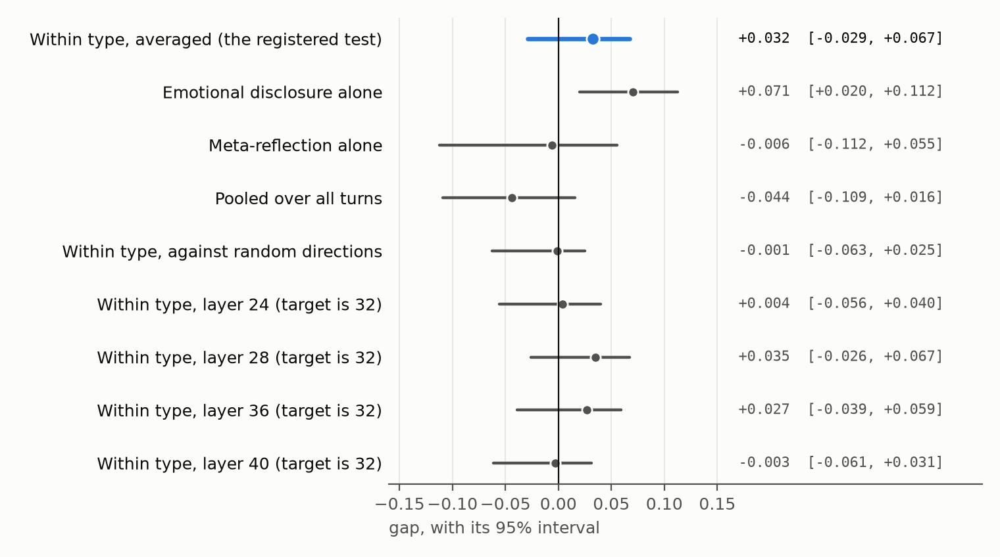

# Steering Is Not Measurement: The Assistant Axis Shows No Clear Advantage as a Drift Monitor

**Does the Assistant Axis projection track judged persona drift better than other persona
directions do, once conversation type is held fixed?**

The axis under test is the one released with Lu et al.,
[*The Assistant Axis: Situating and Stabilizing the Default Persona of Language Models*](https://arxiv.org/abs/2601.10387)
(arXiv:2601.10387).

## Result

**The Assistant Axis does not clear the registered bar.** The axis separates turns judged to
show drift from those judged not to (AUC 0.76 in emotional-disclosure conversations, 0.63 in
meta-reflection), but the test asks whether it does so better than directions never built for
the purpose. Its advantage over the 95th percentile of 275 other persona directions, computed
within each conversation type and averaged, is 0.032, with a 95% interval of −0.029 to 0.067: not
distinguishable from zero at this sample size.



**How to read the figure.** Each row is a gap: the axis's score minus the 95th percentile of the
off-target directions' scores. The dot is the estimate and the line is its 95% interval, from
redrawing whole conversations. A row entirely right of zero means the axis clears the bar.

- **The registered test (blue, top)** averages the gaps for the two conversation types that have
  enough drift to enter. Its interval crosses zero: a null. A centred (basic) bootstrap
  interval, not registered, gives −0.003 to 0.094: the reading holds, close to the boundary.
- **Emotional disclosure alone clears the bar** (0.071, 0.020 to 0.112), and the axis ranks
  first of 276 directions there. It does not clear the random-direction bar in emotional disclosure conversations (0.012,
  −0.028 to 0.040), and an exploratory analysis finds that the axis and its competitors draw on
  one principal component that rises with the turn number. Ranking first is not a margin over a
  control.
- **Meta-reflection alone does not** (−0.006, −0.112 to 0.055), nor does the pooled figure
  (−0.044), the within-type gap against 1,000 random directions (−0.001), or the within-type gap
  at any of the four other layers captured.

**The implication.** A direction that works as a lever for steering behaviour is not thereby a
valid gauge for monitoring it. A persona direction proposed as a monitor needs its own test of
measurement validity.

The full account, with methods, limitations and an exploratory lead for the next experiment, is
in [`WRITEUP.md`](WRITEUP.md). The question, statistic, gates and rubric were committed in
[`PREREGISTRATION.md`](PREREGISTRATION.md) before labelling. Every departure is listed in its
section 15, including the revision of the rubric and the judge model after the first judge
validation fell below its registered minimum.

## Why it matters

An organisation that deploys an assistant with a system prompt needs two things. The assistant
has to keep the same persona and the same honesty over a long conversation, and the monitor that
reports on it has to be trustworthy. The failure that matters most is drift toward telling users
what they want to hear.

The Assistant Axis (arXiv:2601.10387) is a direction in activation space proposed as such a
monitor: a low projection onto it is read as drift away from the default Assistant persona. A
correlation with judged drift says little about that direction if other directions correlate
just as well. The persona-vectors paper (arXiv:2507.21509)
reports off-target directions correlating with behaviour, and the probing literature has
required a control comparison since "Designing and Interpreting Probes with Control Tasks"
(arXiv:1909.03368). This study applies that comparison to turn-level monitoring with the
Assistant Axis.

## Design in brief

- **Model:** Qwen 3 32B, thinking mode off. One model only.
- **Measure under test:** the projection of the mean response-token activation onto the
  **released** Assistant Axis, at the layer the authors' package configures for the model.
- **Outcome:** an LLM judge's rating of drift on each assistant turn, on a rubric written in
  advance and validated against human labels before use.
- **Off-target bar:** the same statistic for 275 directions built from the released role
  vectors, and for 1,000 random directions.
- **Acceptance criterion:** the gap between the target and the 95th percentile of the
  role-direction distribution, computed within conversation type. The whole distribution is
  reported with the target's rank in it.
- **Data:** 70 newly generated conversations of up to 15 assistant turns, in three strata, with a
  simulated user.

The readings of each possible outcome are fixed in advance in the pre-registration. A null is
reported as a null.

**What this cannot settle.** The judge is the criterion, so the study cannot say which measure is
right when the projection and the judge disagree. That needs a third criterion, and the design
for it is described in the pre-registration as designed and not run.

## Reproducing

```
make setup          # pinned laptop environment
make fetch-vectors  # download the released axis and role vectors (pinned revision)
make gate1          # gate 1: released axis against the first principal component of the role vectors
make simulate       # sample-size simulation on synthetic data
                    #   (53 scenarios x 1,000 replicates: over an hour on a small machine;
                    #   python src/analysis/sample_size_sim.py --smoke checks it in seconds)
make gate2          # GPU: gate 2, memory for one full-length conversation with capture
make gate3          # GPU: gate 3, the axis separates default replies from persona replies
make pilot          # GPU + paid API: the six pilot conversations
make judge-pilot    # paid API: rate every pilot turn on the draft rubric
make gate4          # gate 4: base rate of judged drift in the pilot
make length-probe   # GPU: reply lengths without the cap, memory at long contexts (not study data)
make test           # unit tests
make generate       # GPU + paid API: the 70 main-run conversations and activation capture
                    #   (to split across N instances: python src/generate.py ... --shard I/N, then src/merge_shards.py)
make project        # per-turn projections, target and off-target (laptop; needs the activation files)
make label-sample   # draw the 120 turns for the human labels (labels/sample_main.json; fixed once drawn)
make label          # label them in a browser on this machine (items 41 to 120, final rubric); labels are saved as they are made
make judge          # paid API: the judge on items 41 to 120, its validation, then every turn (skips turns already rated)
make analyze        # the registered tests on the main run (results/main/analysis.json)
make exploratory    # not registered: the analyses of section 4.5 of the write-up (needs the activation tensors)
make sensitivity    # not registered: centred bootstrap intervals (results/main/sensitivity_basic_interval.json)
make figures        # the descriptions of section 16.3 and every figure in the write-up
```

Seeds are fixed in `configs/study.toml`. Every figure in the write-up is generated by a script in
`src/analysis/` from files in `results/`. Activations and model weights are not committed;
[`DATA_AND_MODELS.md`](DATA_AND_MODELS.md) records every model, vector set and dataset with its
licence and says how to regenerate what is excluded.

## Layout

```
PREREGISTRATION.md   question, statistic, gates, rubric: committed before labelling
WRITEUP.md           the research write-up
DATA_AND_MODELS.md   models, vectors, licences, seeds, compute
configs/             model, layer, sample and seed settings
src/                 vector loading, gates, generation, projection, judge
src/analysis/        the gap statistic, the simulation, figures
labels/              the turns drawn for labelling, and the human labels
results/             small result tables and figures
tests/
```

## Limitations

One model. Simulated users. One human labeller. The judge is the criterion, and it was validated
against that single labeller, who may apply the rubric less consistently than the judge does;
agreement with one human may be the wrong benchmark for a model judge (see section 3 of
[`WRITEUP.md`](WRITEUP.md)). The axis and role vectors are the authors' released files and are
not recomputed here.

## Author

Quantitative social scientist; two decades leading measurement and evaluation programmes, now
applied to model internals.

## Licence

See [`LICENSE`](LICENSE). The Assistant Axis baseline code carries no licence; it is installed
and called as a dependency for the GPU stages and none of it is copied here.
