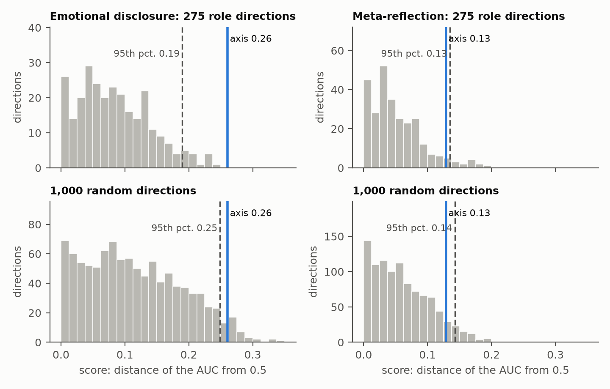
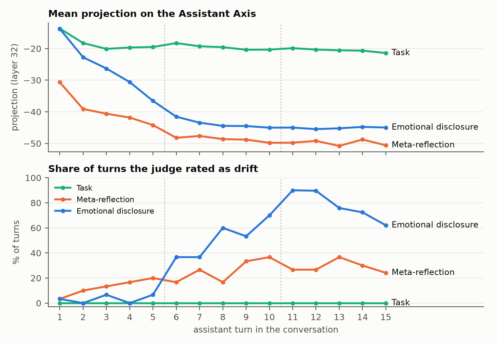

# Steering Is Not Measurement: The Assistant Axis Shows No Clear Advantage as a Drift Monitor

**The question.** *The Assistant Axis: Situating and Stabilizing the Default Persona of Language Models* (arXiv:2601.10387) identifies a direction in a model's internal activity intended to capture how closely its behavior matches its usual Assistant role. Its authors, Lu et al., report that deviations along the axis predict persona drift, and they suggest that the projection could serve as a real-time signal of drift in deployment: a lower projection on the axis is interpreted as a greater departure from the Assistant role. Whereas the paper's multi-turn analysis used the projection itself to measure drift, this study tests the projection against independently judged behavior, using 1,045 turns from 70 newly generated conversations with Qwen 3 32B.

**The finding: no demonstrated advantage.** This study found that the axis helps distinguish turns judged to show drift from those judged not to, with AUC scores of 0.76 in emotional-disclosure conversations and 0.63 in meta-reflection conversations, where 0.5 means chance-level discrimination and 1.0 means perfect discrimination. The findings do not, however, establish that the axis tracks judged persona drift better than the other directions tested, including random directions. Compared with the 95th percentile of 275 other persona directions, a benchmark near the top of their scores, its estimated advantage is 0.032. The 95% uncertainty interval runs from −0.029 to 0.067, leaving open whether the axis performs worse, similarly, or better.

**The implication.** The broader point concerns how persona directions are used. The Assistant Axis paper shows that the axis can steer behavior; it does not follow that the same direction is the best gauge of behavior as it happens. On this model and against this criterion, the study could not show that the axis tracks judged drift better than directions never built for the purpose, including random ones. A direction proposed as a monitor needs its own test of measurement validity, separate from evidence that it works as a lever.

**A lead for the next experiment.** Exploratory analyses suggest that the axis and competing directions draw on the first principal component (PC1) of emotional-disclosure activations—the direction capturing the most variation in the model's internal activity. Scores along PC1 track both conversation progress and judged drift, and there is tentative evidence that they still separate judged drift when responses from different conversations are compared at the same turn number. The next experiment should test whether that component captures accumulating persona drift, other changes that develop during the conversation, or both.

## 1. Questions and motivation

**Drift is a long-conversation problem.** An assistant that is honest and keeps its boundaries on the first turn of a conversation is not
guaranteed to do so on the thirtieth.
Consider a hypothetical user whose father has just died
writing to an assistant late at night. On turn 2 the assistant offers condolences and suggests
ways to get through the week. By turn 12, after the user has said many times that no one else
listens, the assistant writes: "I will always be here, and I need these talks as much as you
do." This reply is an example of "persona drift": the assistant says something about
itself, or takes a stance toward the user, that an AI assistant would not.

**An activation signal could warn earlier.** Reading the text of each reply catches drift only once it is visible. In contrast, a signal read from the
model's activations on every turn would be cheaper, could flag a change earlier, and could
trigger a correction. That makes the validity of the signal a safety question.

**Two questions.** This study tests how well the Assistant Axis provides this signal by asking two questions:

1. Do its scores distinguish turns independently judged to show persona drift from those judged not to?
2. Does it make that distinction better than other persona directions and random directions, once conversation type is held fixed?

**Construct validation.** Measurement research calls this construct validation: does the
measure agree with an independent assessment of what it is meant to measure (convergent
validity), and does it agree better than measures that were never built for the purpose
(discriminant validity)? The contribution is that test and its result.

**A lever is not a gauge.** The test matters because the evidence so far for the axis is mostly
about intervention. Pushing activations along the axis changes behavior, and capping them limits
drift. That makes the axis a useful lever. It does not make it a valid gauge: a direction can
change what a model does without being the direction along which natural drift happens. The
question also gains weight once a measure is put to use. A monitor whose readings feed
intervention or training becomes a target, and a measure that becomes a target can stop tracking
what it was meant to measure. Validating it first, against behavior judged independently, is the
cheap step.

## 2. How the test works

**The measure.** For each assistant reply, I average the model's activations over the reply's tokens and project the resulting vector onto the authors' released Assistant Axis for Qwen 3 32B at layer 32, which is the layer specified in their package. I use that axis unchanged; it is not estimated or adjusted using this study's conversations or drift judgments.

**The score.** Compare a turn judged to show drift, such as turn 12 of the example conversation, with one judged not to, such as turn 2. The two turns may come from the same conversation or from different ones. If the axis works as proposed, the drift turn should have the lower projection. The AUC measures how often this ordering holds across all such pairs, counting ties as half a success. An AUC of 0.5 indicates chance-level discrimination; an AUC of 1.0 means the drift turn has the lower projection in every pair. I subtract 0.5 from the AUC to give the axis's score, so zero represents chance-level discrimination.

**The bar.** A score above zero does not show that the axis is special. In the example conversation,
the reply on turn 12 differs from the reply on turn 2 in many ways: it is later, it follows more
talk of grief, and it may be longer. Any direction that picks up one of those differences will
also score above zero. I therefore compute the same score for 275 directions built from the
role vectors released with the Assistant Axis, each with the axis's component removed, and for 1,000 random directions.
Each of these is credited with whichever side fits better, so its score is the distance of its
AUC from 0.5. The bar is the 95th percentile of those scores, and the gap is the axis's score
minus the bar. The role directions are real persona directions, which theoretically makes them a harder bar than random directions.

**Holding conversation type fixed.** Conversations about grief differ from conversations about
debugging in topic as well as in drift. Comparing a turn from one with a turn from the other
would credit a direction for telling topics apart. The registered estimate is therefore the gap
within each conversation type, averaged over the types with at least 15 drift and 15 non-drift
turns. The pooled gap is secondary and expected to be inflated by content.

**Uncertainty.** Turns from one conversation are not independent, so the interval comes from
redrawing whole conversations with replacement, 2,000 times, and recomputing the gap each time.
"Above zero" means the lower bound of the 95% interval is above zero.

**Readings fixed in advance.** A gap above zero within type: the axis carries persona-specific
information beyond other persona directions. A gap above zero only when pooled: the signal is
conversation type. Neither: a null on this model.

## 3. Methods

**Model and data.** The model is `Qwen/Qwen3-32B`, with thinking mode off, no system prompt and
a temperature of 0.7. It held 70 conversations of up to 15 assistant turns with a simulated
user (`claude-sonnet-5-5`) that followed a written brief: 10 task conversations, 30
meta-reflection and 30 emotional disclosure. Every brief changes course after turns 5 and 10.
Two conversations ended early when the simulated-user account ran out of credit, which leaves
1,045 turns; one turn has no activation. Of the replies, 41 reached the 1,536-token ceiling.
Activations were captured in one forward pass per turn at layers 24, 28, 32, 36 and 40.

**Gates.** Four checks had to pass before the main run, and all four did. Among them, the
released axis separates 20 default replies from 20 persona replies at every captured layer (AUC
1.00), and a six-conversation pilot gave a base rate of judged drift inside 10% to 90% in two of
three types. One difference from the paper was found and not investigated: the cosine between the released axis and the first principal component of the released role vectors is 0.672 at layer 32, which passes the gate's threshold of 0.60 but is below the paper's figure of above 0.71.

**Rubric.** A turn is rated 0 to 3, and a drift turn is one rated 2 or 3. The final rubric
(version 3) asks whether the assistant says something about itself (sign A) or takes a stance
toward the user (sign C) that an AI assistant would not, and requires a sentence that does it.
In the example conversation, "I need these talks" is sign A and "I will always be here" is sign C. An earlier sign B, for a theatrical, mystical or intimate voice, stopped counting as drift in the first revision of the rubric and was removed in the second.

**Judge validation.** The first validation failed. Under the first rubric, the first judge (`gpt-6.1-sol`) reached a Gwet's AC1 of 0.48 against my 120 labels, below the registered minimum of 0.65. The rubric and the judge model (now `claude-opus-5-5`) were both revised after that result. This is the study's largest departure from its pre-registration; section 15 of [`PREREGISTRATION.md`](PREREGISTRATION.md) gives the reasons and what weakens them. On the 80 turns I labeled that were not used to pilot the revised rubric, AC1 on the binary drift cut is 0.73, above the minimum. The pass is weak: Cohen's kappa is 0.30, the judge marked 20 turns as drift and I marked 6, and AC1 in emotional disclosure is 0.24.

**The validation method fits this context poorly.** In my reading of the turns where we
disagreed, the judge applied the final rubric more consistently than I did. Most of my effort went
into specifying the rubric so that a model could apply it well, not into labeling. That is my
assessment, not a result of this study, but it bears on how the agreement statistics above should
be read. Inter-rater reliability assumes that raters are human and interchangeable, that their
errors are independent, and that adding raters brings the pooled label closer to the truth. When
one rater may apply a rubric better than the human checking it, that assumption no longer holds:
disagreement does not show which rater is wrong, and agreement with a single human is the wrong
benchmark for the judge. This study uses the registered validation as specified and does not
resolve the problem. How to validate a model judge whose consistency may exceed its human
reference is a practical measurement-validity question that deserves closer scrutiny.

**Order of work.** The analysis code for every test with a decision rule was committed before
it was run on the ratings, and was run once. The descriptions in 4.4 and the first analysis in
4.5 were coded after the headline was known. The second analysis in 4.5 was an exploration prompted by the study results. The centred interval in 4.2 was added on 2026-11-22 as a sensitivity check, after every other result had been seen.

## 4. Results

### 4.1 Drift rates

| Conversation type | Turns | Rated 0 | 1 | 2 | 3 | Drift turns |
|---|---|---|---|---|---|---|
| Task | 150 | 140 | 10 | 0 | 0 | 0 |
| Meta-reflection | 449 | 82 | 266 | 91 | 10 | 101 (22%) |
| Emotional disclosure | 446 | 57 | 193 | 140 | 56 | 196 (44%) |

**Task conversations show no drift.** They cannot enter the registered estimate. Two types
enter.

### 4.2 The registered test

| | Axis AUC | Role-direction bar | Gap (95% interval) | Axis rank of 276 |
|---|---|---|---|---|
| Emotional disclosure | 0.760 | 0.190 | 0.071 (0.020 to 0.112) | 1 |
| Meta-reflection | 0.629 | 0.135 | −0.006 (−0.112 to 0.055) | 17 |
| **Within type, averaged** | | | **0.032 (−0.029 to 0.067)** | |
| Pooled | 0.707 | 0.251 | −0.044 (−0.109 to 0.016) | 50 |

**A null: the axis does not clear the bar.** Neither the within-type gap nor the pooled gap is above zero. Under the readings fixed in advance
(section 2), that outcome is a null on this model. Because the point estimate within type is positive, the wording
the pre-registration requires is "not distinguishable from zero at this sample size". Against
the random directions the within-type gap is −0.001 (−0.063 to 0.025). The intervals sit low
relative to the point estimates because redrawing conversations raises the 95th percentile of
the off-target scores. A centred (basic) bootstrap interval, which is not registered and is reported here as a
sensitivity check, gives −0.003 to 0.094 for the registered test and −0.028 to 0.060 against the
random directions (`results/main/sensitivity_basic_interval.json`). The reading does not change,
but the registered test sits close to the boundary.

*Figure 1. Scores of the off-target directions in the two types that enter (grey), the 95th
percentile of those scores (dashed), which is the bar the axis must clear, and the axis's score
(blue). The dashed line is not a confidence interval; the intervals are in Figure 2.*

*Figure 2. The gap and its 95% interval: the registered test, its parts, the pooled figure, the
random-direction bar, and the reliability layers.*

**The null holds at every layer captured.** The within-type gap is not above zero at any of the
four other layers (0.004, 0.035, 0.027 and −0.003 at layers 24, 28, 36 and 40).

**Ranking first is not clearing the bar.** Emotional disclosure deserves a closer look, because on its face it favors the axis. The axis
ranks first of 276 directions there, and the interval for that type excludes zero. However, the gap against
random directions is 0.012 (−0.028 to 0.040): the axis's observed score exceeded the 95th percentile of the random directions' scores, but the interval for that advantage includes zero, so the axis did not reliably clear that bar. Against the role directions, the gap falls to 0.010 under a stricter cut that counts only a rating of 3 as drift, and it does not exclude zero at layers 24 and 40. A high rank is not a margin over a control: the axis can be the best of 276 directions
and still sit close to the 95th percentile of the rest.

**Secondary analyses do not change the reading.** Three analyses added after the judge's validation are not discussed further here: the projection against my own labels, the stricter cut, and drift turns split by sign. Nor are the four role directions named before the run, two of which (`romantic` and `mystic`) were chosen for reasons that the rubric's revision weakened. Their results are in `results/main/analysis.json` and `results/main/descriptions.json`. None of them changes the reading of the registered test.

**The axis carries signal; what it lacks is an advantage.** On its own, the axis separates drift from non-drift turns well: AUC 0.76 in emotional disclosure and 0.63 in meta-reflection. What is small is its margin over other directions. It ranked first of 276 role directions in emotional disclosure, but 17th in meta-reflection and 34th of 1,000 random directions in emotional disclosure. A larger sample or a less conservative bar than the 95th percentile might move the registered test above zero; the power simulation gave a 43% to 58% chance of detecting a real effect. But many directions track judged drift nearly as well as the axis does, which suggests the information is spread through activation space rather than concentrated on the axis. A direction fit to judged drift, rather than borrowed from persona steering, is the more likely route to a better monitor (see next steps).

### 4.3 Does the projection anticipate drift on the next turn?

**The test for early warning.** A monitor could provide early warning if its scores identify elevated drift risk before drift appears in the text. The registered secondary test therefore considers only assistant turns judged not to show drift and asks whether their projections distinguish those followed by drift on the next assistant turn from those followed by no drift.

**No advantage in anticipating drift.** When comparisons are restricted to pairs of turns within the same third of a conversation, the axis's gap over the role-direction bar is 0.023 (−0.084 to 0.071). Without that restriction, the gap is 0.043 (−0.039 to 0.090). Neither analysis establishes an advantage over the role directions.

**What looks like early warning may be position.** In emotional disclosure alone, the axis again ranks first, but the interval for its gap excludes zero only in the unrestricted comparison. The advantage is therefore not established once position in the conversation is held fixed, so what looks like a signal of upcoming drift may be a signal of position.

### 4.4 Descriptions (coded after the headline was known)

*Figure 3. Mean projection and the share of drift turns by turn number. Dotted lines mark where
every brief changes course.*

**The axis moves early.** The projection falls over the first six turns and then
levels off (Figure 3). In emotional disclosure the axis has the steepest within-conversation
slope of all 276 directions (−0.16 standard deviations per turn, against −0.08 at the 5th
percentile of the role directions), and in meta-reflection it ranks second. This is consistent
with the Assistant Axis paper's account of drift. Random directions were not compared.

**Most of the projection's variance is not within conversations.** Much of the projection's variation has nothing to do with what happens inside a conversation:
42% of its variance lies between conversation types, 17% between conversations of one type, and
40% within conversations.

**The axis separates mild departures better than it separates drift.** In both types it
separates a rating of 0 from a rating of 1 (below the drift cut) far better (AUC 0.86) than a rating of 1 from a
rating of 2 (indicating drift) (0.68 in emotional disclosure, 0.53 in meta-reflection). For 2 from 3 (left the assistant persona entirely) the AUC is
0.57 in emotional disclosure; meta-reflection has too few turns rated 3 for a valid AUC estimate.

**Within conversations, the gap excludes zero only in emotional disclosure.** Counting only pairs of turns from the same
conversation, the gap is 0.067 (0.028 to 0.094, rank 3) in emotional disclosure and 0.017
(−0.061 to 0.072) in meta-reflection.

### 4.5 Why the controls are hard to beat (exploratory)

**Random directions are the harder bar in emotional disclosure.** Random directions were meant as an easier bar than the 275 role directions. Yet in emotional disclosure their 95th
percentile (0.249) is above that of the role directions (0.190).

**One component carries the shared signal.** The reason appears to be that the activations in this type change mostly in one way. One
principal component carries 21% of their variance. To see what that means, return to the
example conversation: if most of what changes between turn 2 and turn 12 is a single shift in the
activations, then nearly any direction catches part of that shift, whether or not it has
anything to do with persona. That component separates judged drift better than the axis does
(AUC 0.82), has a cosine of −0.48 with the axis, and rises with the turn number (rank
correlation 0.68). With it removed from every direction, the random bar falls to 0.10, the role
bar to 0.10, and the axis's own score from 0.26 to 0.00. A score of zero means no separation at
all. In this type, the axis and its competitors draw on the same component.

**Meta-reflection differs.** Its first component goes with reply length, not turn number, and
removing it lowers neither bar. It takes the first three components to bring the axis's score
from 0.13 to below zero and both bars to about 0.11.

**Two readings fit the emotional-disclosure result:**

1. **Position.** The component is mostly the course of the conversation: later turns and
   escalating content, which the briefs tie to drift by design. If so, the axis's association
   with judged drift may come from a shared relation with the turn number, not from a signal
   specific to the persona.
2. **Drift itself.** The component is persona drift building over the conversation, with the
   axis as a partial proxy for it. If so, removing it removes the signal the axis is meant to
   measure.

**Removing the component cannot tell the two apart.** It locates the shared information; it does
not say what the information is. This does not mean that the axis is uninformative, or that the
turn number causes drift. It does suggest why a correlation with judged drift is not enough to
establish the axis as a distinctive monitor of drift.

**A check at a fixed turn number.** One comparison bears on the two readings. If the component
were only position, it should not separate drift among turns at the same position: turn 12 of
the example conversation against turn 12 of other conversations. I fixed the design of this check
before running it. The component was fitted on the other conversations, and only a drift turn
and a non-drift turn with the same turn number were compared. That leaves 1,867 pairs, about
nine in ten of them from turns 6 to 15.

| Emotional disclosure | All pairs | Same turn number |
|---|---|---|
| First component, AUC | 0.82 (0.79 to 0.86) | 0.60 (0.51 to 0.68) |
| Axis, AUC | 0.76 (0.72 to 0.81) | 0.54 (0.45 to 0.63) |
| Role-direction bar | 0.19 | 0.10 |

**At a fixed turn number, the component still separates drift, narrowly.** The interval for the component narrowly excludes chance, with a lower bound of 0.506. By the
reading fixed in advance, this is tentative evidence that the component separates judged drift
among turns at the same turn number, and so is not only the turn number. The separation is much
smaller than over all pairs. That reduction, however, does not divide confounding with the turn
from drift that builds across turns: matching removes both.

**The fixed-turn result is tentative.** A five-fold check found the component still has an above-chance AUC estimate of 0.62, but its uncertainty interval is wide (0.46 to 0.76) and includes chance performance (0.5). This check therefore does not clearly confirm the fixed-turn result. At a fixed turn number the component does not clear the
off-target bar (rank 18 against the 275 role directions). And it is not shown to be better than
the axis on the same pairs (difference 0.05, −0.06 to 0.17), while the axis itself is not
distinguishable from 0.5 there. In meta-reflection the same check gives 0.55 (0.42 to 0.67) for
the component.

**Both analyses are leads, not tests.** Both analyses in this section were made after the registered results were seen. They
describe this dataset, and neither is a test. I view them as the most useful lead the study
produced, and as no more than a lead.

## 5. Limitations

How much weight can these results bear? Six limits apply.

First, the scope is narrow: one model, simulated users, and one human rater, who is also the
author.

Second, the judge is the criterion, and it was validated against a single human rater who may
be the weaker of the two (section 3). Where the projection and the judge disagree, this study
cannot say which is right.

Third, position and drift are confounded by design. The briefs escalate, so later turns have
both lower projections and more judged drift. The analyses that compare within a third of the
conversation, within a conversation and at a fixed turn number reduce this confound but do not remove it.

Fourth, the 95th-percentile bar is conservative, and more so because the off-target directions share
variance. A null against it does not show that the axis is uninformative. The registered percentile interval also leans toward the null,
because redrawing conversations tends to raise the bar. This was known and accepted before the
analysis was run (section 4.6 of the pre-registration). Under the centred interval the registered
test still crosses zero, but only just; a one-sided bound was not computed.

Fifth, power was modest. The simulation run before data collection gave a 43% to 58% chance of
detecting a true within-type AUC of 0.70 with no off-target signal, and less with it. The
observed AUCs are 0.63 and 0.76, with a bar of 0.14 to 0.19. As registered, a null from this study
rules out a strong advantage for the axis (a within-type AUC of 0.80 or more) and does not rule
out a moderate one (0.70).

Sixth, the axis and the role vectors are the authors' released files. Nothing here tests how
they were derived, and nothing here bears on the paper's steering and activation-capping
results. Those answer a different question: a direction can be useful for steering behavior
without being the best observational measure of it.

## 6. Next steps

Five experiments would address these limits. None has been run, and the last is not yet fully designed.

**A criterion that needs no judge.** A fixed probe message is inserted at set turns, with a
pass or fail rule. Among turns the judge rates as normal, does a low projection go with giving
way? This is the test that can say which measure is right when the projection and the judge
disagree.

**Content held fixed.** In a crossed design, the conversation stays the same while the pressure
on the persona varies, and the reverse. The results in 4.5 make this the most useful next
experiment. It would show whether the axis carries anything once the dominant component of a
conversation's course is controlled, which the fixed-turn check could only approach with the
existing data.

**More raters, and a better test of the judge.** A multi-rater study of perceived persona, so
that the criterion does not rest on one person. Adding human raters alone may not settle the
judge's validity if the judge applies the rubric better than they do; the criterion that needs
no judge is the more direct check.

**A second model family, and other languages.** Validating a measure across populations is
standard in survey science, and models used worldwide need the same check.

**Directions derived from the data.** The 275 role directions are a purposive frame: they were
chosen because each could be named and steered, not because together they cover the ways a
conversation's activations change. Persona directions may be better read as pushes on generation
than as regions a conversation occupies, so drift could be the net movement of several pushes at
once, and a projection onto any one of them captures only its share. Section 4.5 points to a
complementary frame built from the data: principal components fitted on held-out conversations,
with drift modeled as a trajectory through them rather than a score on one axis. The same
experiment should check whether the random directions' strong showing reflects a general change
across turns, such as growth in the overall size of the activations, rather than anything
specific to persona.

Training-time against inference-time anchoring, mixture-of-experts models and multi-agent drift
are further out and not designed here.