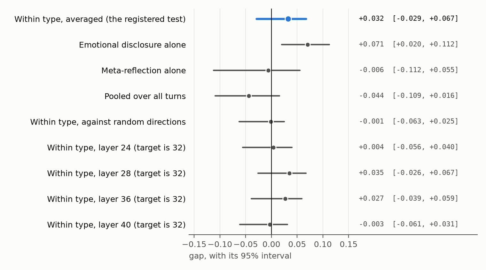

# Does the Assistant Axis track judged persona drift better than other persona directions?

> **Draft for the author's review (2026-11-19).** Every figure in this document is in
> `results/` and every departure from the pre-registration is in section 15 of
> [`PREREGISTRATION.md`](PREREGISTRATION.md).

**Result in one paragraph.** On 1,045 turns of 70 newly generated conversations with Qwen 3 32B,
the projection onto the released Assistant Axis falls as a conversation goes on. In
emotional-disclosure conversations it falls faster than the projection onto any of 275 other
persona directions, and in meta-reflection conversations faster than all but one. This is
consistent with the paper's account of drift; it is a description, computed after the main result
was known. The projection also separates turns that a validated judge rates as persona drift from
turns it does not (AUC 0.76 in emotional disclosure, 0.63 in meta-reflection). It is not shown to
do so better than other persona directions. The registered statistic, the gap between the axis's
score and the 95th percentile of 275 role-direction scores within conversation type, is 0.032
with a 95% interval of −0.029 to 0.067: not distinguishable from zero at this sample size. An
exploratory analysis suggests why other directions are hard to beat in emotional disclosure. The
largest single pattern in the activations there, 21% of their variance, follows the turn number,
and the judge rates more turns as drift later in a conversation. Directions that overlap this
pattern separate drift turns too, whether or not they measure the assistant persona. The study
cannot say whether the pattern is position in the conversation or the drift itself.

## 1. Question and motivation

An organisation that deploys an assistant needs it to keep the same persona and the same honesty
over a long conversation, and needs a monitor it can trust to say when that fails. The failure
that matters most is drift toward telling users what they want to hear.

**Why drift detection matters for safety.** A model's character is mostly tested on short
exchanges and mostly used in long ones. Nothing guarantees that an assistant which is honest and
keeps its boundaries on the first turn still does so on the thirtieth, after the context has
filled with one user's framing. The conversations where this matters most are the ones where
the user is most exposed: someone in distress, or someone pressing the model about its own
nature. Checks on the output catch such a failure only once it is visible in the text. A signal
read from the activations on every turn is cheap, could flag a change earlier, and could be used
to trigger a correction. That makes the validity of the signal a safety question. A monitor that
responds to the course of a conversation and not to the persona gives false alarms in exactly
the conversations that need care, false assurance elsewhere, and a correction that acts on the
wrong thing.

**Where this study sits.** Work on drift falls into three kinds: behavioural evaluation of long
conversations by judges or raters; monitors read from activations, such as probes and
directions; and checks that such a monitor measures what it is said to measure. The Assistant
Axis is of the second kind. This study is of the third, applied to that axis, with the first as
its criterion. It asks two things of the projection: does it agree with an independent judge of
drift, and does it agree better than directions that were not built to measure drift? Survey
science calls these convergent and discriminant validity. No new method is proposed.

The Assistant Axis (arXiv:2601.10387) is a direction in activation space proposed as such a
monitor: a low projection onto it is read as movement away from the default Assistant persona.
A projection that correlates with judged drift is not yet evidence about that direction, because
other directions may correlate with drift as well.

That a measure must be read against a control is well established. "Designing and Interpreting
Probes with Control Tasks" (arXiv:1909.03368) argues that a probe's accuracy has to be set
against its accuracy on a control task; its controls are of a different kind from the direction
comparison used here. The closer precedent is the persona-vectors paper (arXiv:2507.21509). It
reports correlations of 0.76 to 0.97 between a model's shift along a trait's vector and its
expression of that trait, against 0.34 to 0.86 for its cross-trait baselines. The matching
directions do better there, and the other directions still correlate substantially.

Three claims about the Assistant Axis should be kept apart:

1. Activations move along the axis during certain conversations.
2. That movement tracks drift as assessed independently of the projection.
3. The axis tracks that drift better than suitable control directions do.

Section 4.1 of the paper shows the first, with projections averaged at each turn position. In
that multi-turn analysis drift is the projection itself, and no comparison with random or
off-target persona directions was found. The paper does compare the axis with the first
principal component of its role vectors, including for drift (Appendix G); that component is an
alternative construction of the same direction, not an off-target control. The paper uses
behavioural judges elsewhere: in its steering and jailbreak evaluations, and in relating the
projection of a role-prompted first turn to the rate of harmful replies on the next turn
(section 4.3). Nothing in this study bears on those results. These remarks rest on a full
reading of the paper's text and a short search, not a systematic review.

This study tests the second and third claims for one model, with a judge of drift validated
against human labels, set against the projection turn by turn, and an off-target bar. The
question is narrow:

**Does the Assistant Axis projection track judged persona drift better than other persona
directions do, once conversation type is held fixed?**

## 2. Approach

- **Measure under test.** The projection of the mean response-token activation onto the
  authors' released axis, at layer 32, the layer their package configures for this model. No
  axis is fitted here.
- **Off-target bars.** The same statistic for 275 directions built from the released role
  vectors (mean removed, axis component removed, unit length), and for 1,000 random unit
  directions. Role directions are real persona directions, which makes them the harder bar by
  design.
- **Statistic.** For a direction, the AUC is the probability that a drift turn has a lower
  projection than a non-drift turn. The axis's score is `T = AUC − 0.5`, one-sided. Each
  off-target direction scores `|AUC − 0.5|`, so it is credited with whichever side fits better.
  The gap is `G = T − P95(off-target scores)`.
- **Estimand.** `G` within conversation type, averaged over the types with at least 15 drift
  and 15 non-drift turns. The pooled figure is secondary and expected to be inflated by content.
- **Uncertainty.** A bootstrap over conversations, 2,000 resamples. "Above zero" means the lower
  bound of the 95% interval is above zero.
- **Readings fixed in advance.** A gap above zero within type: the axis carries
  persona-specific information beyond other persona directions. Above zero pooled only: the
  signal is conversation type. Neither: a null on this model.

## 3. Methods

**Model and data.** `Qwen/Qwen3-32B`, thinking mode off, no system prompt, temperature 0.7.
Seventy conversations of up to 15 assistant turns with a simulated user (`claude-sonnet-5-5`)
following a written brief: 10 task conversations, 30 meta-reflection, 30 emotional disclosure.
Every brief changes course after turns 5 and 10. Two conversations ended early when the
simulated-user account ran out of credit, leaving 1,045 turns; one turn has no activation. Of
the replies, 41 reached the 1,536-token ceiling. Activations were captured in one forward pass
per turn at layers 24, 28, 32, 36 and 40.

**Gates.** All four passed before the main run. The released axis agrees with the first
principal component of the released role vectors (absolute cosine 0.67, minimum 0.60). A
15-turn conversation with capture fits on one 80 GB card. The axis separates 20 default replies
from 20 persona replies at every captured layer (AUC 1.00). A six-conversation pilot gave a
base rate of judged drift inside 10% to 90% in two of three types.

**Rubric.** A turn is rated 0 to 3; a drift turn is rated 2 or 3. The final rubric (version 3)
asks whether the assistant says something about itself (sign A) or takes a stance toward the
user (sign C) that an AI assistant would not, and requires a sentence that does it. Voice alone
is not drift.

**The rubric and the judge both changed after the first validation failed.** This is the
study's largest departure from its pre-registration. Under the first rubric the judge
(`gpt-6.1-sol`) reached a Gwet's AC1 of 0.48 against the author's 120 labels, below the
registered minimum of 0.65. The author then reported that the rubric had not been in view while
labelling and questioned the rubric itself, which had been piloted only by the judge. It was
revised, piloted on 40 of the labelled turns with a new judge (`claude-opus-5-5`), revised once
more, and then fixed. All earlier labels and ratings are kept in the repository. Section 15
lists what weakens this: the revision followed a known result, it moved the outcome toward the
author's first reading, the rubric and judge changed together, and the new judge is from the
same model family as the simulated user and as the assistant that helped draft the rubric.

**Judge validation.** On the 80 labelled turns not used in the pilot, AC1 on the drift cut is
0.73, above the minimum. The pass is weak. Cohen's kappa is 0.30. The judge marked 20 turns as
drift and the author 6, agreeing on 5. In emotional disclosure AC1 is 0.24: the judge counts a
promise of permanence ("always here") as sign C, as the rubric says, and the author rated most
such turns 1. Three secondary analyses were registered at that point, before any rating met a
projection: the projection against the author's labels, a stricter cut at a rating of 3, and
the judge's drift turns split by sign.

**Order of work.** The analysis code for every test with a decision rule was committed before
it was run on the ratings, and was run once. The descriptive analyses and one exploratory
analysis were coded after the headline was known, and are marked as such below.

## 4. Results

### 4.1 Drift rates

| Conversation type | Turns | Rated 0 | 1 | 2 | 3 | Drift turns |
|---|---|---|---|---|---|---|
| Task | 150 | 140 | 10 | 0 | 0 | 0 |
| Meta-reflection | 449 | 82 | 266 | 91 | 10 | 101 (22%) |
| Emotional disclosure | 446 | 57 | 193 | 140 | 56 | 196 (44%) |

Task conversations show no drift and do not enter the primary estimand. Two types enter.

### 4.2 The primary test

| | Axis AUC | Role-direction bar | Gap (95% interval) | Axis rank of 276 |
|---|---|---|---|---|
| Emotional disclosure | 0.760 | 0.190 | 0.071 (0.020 to 0.112) | 1 |
| Meta-reflection | 0.629 | 0.135 | −0.006 (−0.112 to 0.055) | 17 |
| **Within type, averaged** | | | **0.032 (−0.029 to 0.067)** | |
| Pooled | 0.707 | 0.251 | −0.044 (−0.109 to 0.016) | 50 |

The registered reading is the third row of the pre-committed table: the gap is not above zero
within type or pooled. The point estimate within type is positive, so the wording the
pre-registration requires is "not distinguishable from zero at this sample size". Against the
random directions the within-type gap is −0.001 (−0.063 to 0.025). The intervals sit low relative
to the point estimates because resampling raises the 95th percentile of the off-target scores.

*Figure 1. Scores of the off-target directions in the two types that enter (grey), the 95th
percentile of those scores (dashed), which is the bar the axis must clear, and the axis's score
(blue). The dashed line is not a confidence interval; the intervals are in Figure 2.*

*Figure 2. The gap and its 95% interval: the registered test, its parts, the pooled figure, the
random-direction bar, and the reliability layers.*

**Layers.** The within-type gap is not above zero at any of the four reliability layers (0.004,
0.035, 0.027 and −0.003 at layers 24, 28, 36 and 40).

**Emotional disclosure alone** is not a registered estimand, and should not be read as the
finding. The axis ranks first of 276 there and the interval for that type excludes zero, but the
gap against random directions is 0.012 (−0.028 to 0.040), it falls to 0.010 under the stricter
cut, it does not exclude zero at layers 24 and 40, and this is the type where the judge and the
author agree least.

### 4.3 Does the projection anticipate drift on the next turn?

The registered secondary test takes turns the judge rates as normal and asks whether the
projection separates those followed by a drift turn. Comparing only pairs in the same third of
the conversation, the gap is 0.023 (−0.084 to 0.071); comparing all pairs it is 0.043 (−0.039 to
0.090). The registered reading is "not above zero either way". In emotional disclosure alone the
axis again ranks first, and the gap clears zero only when position is not held fixed.

### 4.4 The three analyses added after validation

- **Against the author's labels (description).** On the 80 validation turns, with the author's
  6 drift turns, the axis's AUC is 0.745 and its rank 137 of 276. With the judge's 20 drift
  turns on the same 80, the AUC is 0.809 and the rank 5. With 6 drift turns many directions land
  far from 0.5 by chance, so the rank says little.
- **Stricter cut (drift is a rating of 3).** Within type it is not estimable: only emotional
  disclosure has 15 such turns. Pooled, the gap is −0.124 (−0.227 to −0.055).
- **Split by sign.** In emotional disclosure, the gap for drift turns with sign A is 0.108
  (0.019 to 0.158) and for turns with C alone 0.045 (−0.014 to 0.088). The author predicted the
  first would be larger. The direction agrees; the difference, 0.063 (−0.012 to 0.121,
  exploratory), includes zero, and the axis barely tells the two kinds apart (AUC 0.58). The
  projection is low on turns with C alone almost as much as on turns with sign A.

### 4.5 Descriptions (coded after the headline was known)

*Figure 3. Mean projection and the share of drift turns by turn number. Dotted lines mark where
every brief changes course.*

- **Position.** The projection falls over the first six turns and then levels off (Figure 3). In
  emotional disclosure the axis has the steepest within-conversation slope of all 276 directions
  (−0.16 standard deviations per turn, against −0.08 at the 5th percentile of the role
  directions); in meta-reflection it ranks second. Random directions were not compared.
- **Where the variance is.** 42% of the projection's variance lies between conversation types,
  17% between conversations of one type, and 40% within conversations.
- **Which ratings it separates.** In both types the axis separates a rating of 0 from 1 far
  better (AUC 0.86) than 1 from 2, the drift cut (0.68 in emotional disclosure, 0.53 in
  meta-reflection). For 2 from 3 the AUC is 0.57 in emotional disclosure; meta-reflection has
  too few turns rated 3.
- **Inside one conversation.** Counting only pairs of turns from the same conversation, the gap
  in emotional disclosure is 0.067 (0.028 to 0.094, rank 3) and in meta-reflection 0.017 (−0.061
  to 0.072).
- **Around the onset.** With each turn number's mean removed, the projection at the first
  drift turn is 0.07 standard deviations below the type's mean in emotional disclosure, inside
  the 5th-to-95th percentile band of the role directions, and 0.30 below in meta-reflection, just
  outside that band. In meta-reflection it was already 0.18 below on the turn before.
- **Directions named in advance.** None of the four role directions chosen before the run
  (`romantic`, `familiar`, `mystic`, `spirit`) separates drift better than the axis; every
  interval for the difference lies below zero on the primary statistic.

### 4.6 Why the bar is high (exploratory, not registered)

Random directions were meant as the easier bar, yet in emotional disclosure their 95th
percentile (0.249) is above the role directions' (0.190). In that type the activations vary most
along one principal component (21% of the variance). That component separates judged drift
better than the axis does (AUC 0.82), has a cosine of −0.48 with the axis, and rises with the
turn number (rank correlation 0.68). With it removed from every direction, the random bar falls
to 0.10, the role bar to 0.10, and the axis's own score from 0.26 to 0.00. These scores are
distances of the AUC from 0.5, so zero means no separation at all: in this type the axis and its
competitors draw on the same component.

Meta-reflection differs. Its first component goes with reply length, not turn number, and
removing it lowers neither bar; it takes the first three components to bring the axis's score
from 0.13 to below zero and both bars to about 0.11.

Two readings fit:

1. **Position.** The component is mostly the course of the conversation: later turns and
   escalating content, which the briefs tie to drift by design. Then the axis's association with
   judged drift may come from a shared relation with turn number, not from a signal specific to
   the persona.
2. **Drift itself.** The component is persona drift building over the conversation, with the
   axis as a partial proxy for it. Then removing it removes the signal the axis is meant to
   measure.

This analysis cannot tell the two apart, and the component was fitted on the same turns it is
scored on. It does not show that the axis is uninformative, or that turn number causes drift. It
shows why a correlation with judged drift is not enough to establish the axis as a distinctive
monitor of drift. It was computed after the results were seen and is a description of this
dataset, not a test.

## 5. Limitations

- **One model, simulated users, one human rater** who is also the author.
- **The judge is the criterion.** Where the projection and the judge disagree, this study
  cannot say which is right. Agreement between the judge and the author was weak, weakest in the
  type that supplies most drift turns.
- **The rubric and judge were revised after a failed validation.** The outcome analysed here is
  not the one first registered.
- **Position and drift are confounded by design.** The briefs escalate, so later turns have
  both lower projections and more judged drift. The banded and within-conversation analyses
  reduce this and do not remove it, and the two readings in
  4.6 are the two sides of it.
- **The 95th-percentile bar is conservative**, and more so as off-target directions share
  variance. A null against it does not show the axis is uninformative.
- **The axis and role vectors are the authors' released files.** Nothing here tests how they
  were derived.
- **Power.** The simulation run before data collection gave a 43% to 58% chance of detecting a
  true within-type AUC of 0.70 with no off-target signal, and less with it. The observed AUCs
  are 0.63 and 0.76 with a bar of 0.14 to 0.19.

## 6. Next steps

Designed, not run:

- **A third criterion.** A fixed probe message inserted at set turns, with a pass or fail rule
  that needs no judge. Among turns the judge rates as normal, does a low projection predict
  giving way? This is the test that can say which measure is right.
- **Content held fixed.** A crossed design in which the conversation is the same and the
  persona pressure varies, and the reverse. The exploratory result in 4.6 makes this the most
  useful next experiment: it would show whether the axis carries anything once the dominant
  component of a conversation's course is controlled.
- **More raters.** A multi-rater study of perceived persona, so that the criterion does not
  rest on one person.
- **A second model family**, and the same measurement across languages. Validating measures
  across populations is standard in survey science; models used worldwide need the same check.
- **Training-time against inference-time anchoring, mixture-of-experts models and multi-agent
  drift** are further out and not designed here.

## 7. About the author

*To be written by the author.*
